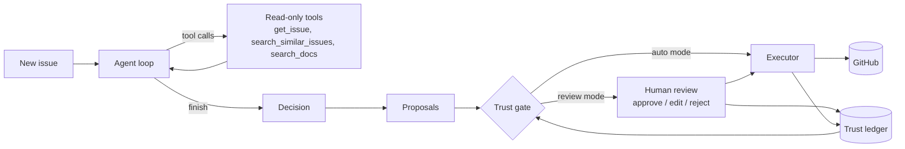

# TriageBot

[](https://github.com/minte-sys/triagebot/actions/workflows/ci.yml)

An LLM agent that triages GitHub issues (labels, duplicates, requests for missing
information) and **earns autonomy** one action type at a time. Every action starts as a
proposal that a human reviews. Only after an action type has a proven track record is it
allowed to run on its own, and even then it is audited and can be undone.

<!-- demo: docs/demo.gif -->

## Why

Issue triage is repetitive, but letting an LLM write to a repository unsupervised is risky:
a wrong label is annoying, a wrong "duplicate of" comment closes the door on a real bug
report. TriageBot treats autonomy as something measured, not assumed:

- The agent only **proposes**. A separate executor is the only code that can write to GitHub.
- Each action type (`labels`, `duplicate`, `request_info`, `comment`) has its own trust
  record, built from review decisions.
- An action type is promoted to automatic mode only after enough unchanged approvals, is
  spot-checked while automatic, and drops back to review on a failed audit or any undo.

## How it works



1. **Agent loop.** A ReAct-style loop with native tool calling (or a JSON fallback for models
   without it). The model can read the issue, search older issues and search the project
   docs, then must end with a `finish` call that returns a validated decision. Steps, time
   and tokens are budgeted, and every step is stored as a trace.
2. **Search.** Duplicate search uses embeddings (cosine similarity, cached by text hash) with
   BM25 keyword search (SQLite FTS5) as a fallback if the embedding call fails. Docs are
   searched with BM25.
3. **Proposals.** A decision is split into one proposal per action. Rerunning an issue
   supersedes its pending proposals.
4. **Executor.** The only writer. It re-validates every payload, adds a hidden marker to each
   comment so an action is never applied twice, and records enough to undo it. A global
   `dry_run` switch (on by default) makes it write nothing.
5. **Trust ledger.** An append-only log of review outcomes, audits and undos per action type.
   Defaults: promote after 20 decisions with at least 90% of the last 20 approved unchanged;
   in automatic mode, hold every 5th action for an audit; demote below 80% audit accuracy or
   on any undo. Automatic mode also needs a global `auto_enabled = true`.
6. **Learning from corrections.** When a reviewer edits or undoes an action and gives a
   reason, the most recent corrections are added to the agent's prompt.

## Safety

- The target repository is fixed in config and checked against an allow-list before every
  GitHub request. The model can never choose which repository to touch.
- Model tools are read-only. Issue text is passed inside delimiters and treated as data; the
  eval set includes prompt-injection cases that must not change the bot's behaviour.
- Secrets come from the environment (`.env`), never from config files or the Docker image.
- The GitHub token is fine-grained and limited to one sandbox repository. In production this
  would be a GitHub App or a dedicated bot account rather than a personal token.

## Evaluation

TriageBot is measured on a synthetic eval set for a made-up project, so that the expected
answers are known and the bot can't have seen them in training:

- 50 issues (bugs, questions, enhancements, documentation, duplicates and 6 prompt-injection
  attempts), 25 older background issues, the project's labels and 5 docs.
- Scores: label precision, recall and F1; duplicates found and false duplicates; requests for
  information; doc citations; injection resistance. A baseline that always answers "bug"
  shows what the numbers would be without any intelligence.
- Runs are resumable (results are saved per case, model and prompt version), and every
  failure links to the trace of that run.

```powershell
triagebot eval --limit 10 --pause 20   # run 10 more cases
triagebot eval --report                # scores, baseline and cases to look at
```

**Agent results:** a full 50-case run with `gemini-3.5-flash` is in progress, because the
free tier allows only part of the set per day. The first 4 cases with prompt v3 were all
correct, including both duplicates. The one apparent miss before that was an error in the
answer key, not in the bot, and the key was fixed.

### Keyword search vs embeddings for duplicates

`triagebot eval-search` ranks the older issues for each query three ways and reports where
the correct duplicate appears.

| Query set | Method | 1st | Top 3 | MRR |
|---|---|---|---|---|
| Duplicates from the eval set (11) | BM25 | 11/11 | 11/11 | 1.00 |
| | Embeddings | 11/11 | 11/11 | 1.00 |
| | Hybrid (RRF) | 11/11 | 11/11 | 1.00 |
| Paraphrases sharing few words (20) | BM25 | 5/20 | 9/20 | 0.34 |
| | Embeddings | 20/20 | 20/20 | 1.00 |
| | Hybrid (RRF) | 10/20 | 18/20 | 0.72 |

Embeddings: `gemini-embedding-001`. The first set hit a ceiling (every method is perfect), so
a harder set of paraphrases was added. Equal-weight reciprocal rank fusion let BM25's wrong
guesses pull good results down, so the agent uses embeddings with BM25 only as a fallback.

## Reliability

Hosted models fail in different ways, and the client treats them differently:

- Overloaded (503), rate-limited (429 per minute) and timed-out calls are retried with
  exponential backoff and jitter, honouring the provider's `Retry-After` or `retryDelay`.
- Errors that waiting can't fix (400, bad key, daily quota) are not retried.
- If the model is still unavailable, the run starts again with a fallback model from config.
  The eval never falls back, so every score comes from one known model.

## Quick start

Requires Python 3.11+.

```powershell
git clone https://github.com/minte-sys/triagebot
cd triagebot
python -m venv .venv
.venv\Scripts\Activate.ps1          # Linux/macOS: source .venv/bin/activate
pip install -e ".[dev]"
copy .env.example .env              # then fill in GEMINI_API_KEY and GITHUB_TOKEN
```

Edit `config.toml` to point `[github] repo` and `allowed_repos` at a repository you own,
then:

```powershell
triagebot ping          # one round trip to the model
triagebot index         # index issues and docs for search
triagebot run 3         # triage issue #3 and create proposals (writes nothing)
triagebot review        # approve, edit or reject them (dry run by default)
triagebot trust         # what each action type has earned
triagebot trace         # list runs; triagebot trace <id> shows one step by step
```

A local model works too: install [Ollama](https://ollama.com), pull the model named under
`[llm.ollama]` and add `--backend ollama` to any command.

### Docker

```bash
docker build -t triagebot .
docker run --rm -it --env-file .env -v triagebot-data:/app/data triagebot run 3
```

The image runs as a non-root user and contains no secrets; the database lives in the
mounted volume.

## Commands

| Command | What it does |
|---|---|
| `ping` | One tool-calling round trip to the model |
| `tools`, `tool` | List the agent's tools, or run one by hand |
| `index` | Build the search index from GitHub issues and docs |
| `run N` | Triage issue N and store proposals |
| `review` | Approve, edit or reject pending proposals |
| `undo ID` | Reverse an executed proposal and record why |
| `trust` | Trust per action type; `--history`, `--demote` |
| `trace [ID]` | Recent runs, or one run step by step |
| `eval` | Run and score the eval set |
| `eval-search` | Compare BM25, embeddings and hybrid search |

## Project layout

```
src/triagebot/
  agent/      agent loop, prompts, budgets, decision schema, JSON tool-call fallback
  llm/        OpenAI-compatible and Ollama clients, retries
  github/     GitHub REST client and models
  tools/      read-only tools the model can call
  search/     BM25 index, docs loader, embeddings, semantic search
  autonomy/   proposals, review, executor, trust ledger, gate, undo, corrections
  eval/       dataset, metrics, runner, reports, search comparison
  trace/      run traces
eval_data/    synthetic eval set
tests/        139 tests; the model and GitHub are faked, so no keys are needed
```

## Development

```powershell
pytest -q
ruff check src tests
```

GitHub Actions runs both on Python 3.11 and 3.12 for every push to `main` and every pull
request, then builds the Docker image and checks that it starts.

## Limitations and next steps

- The eval set is synthetic and small. It's good for comparing prompts and models, not for
  claiming real-world accuracy.
- Trust thresholds are fixed defaults, not tuned on real review data.
- Only one repository at a time, and triage is started by hand rather than by a webhook.
- Next: a GitHub App with a webhook, comparing more models (including local ones) on the eval
  set, and per-label trust instead of one record for all labels.

## License

MIT
